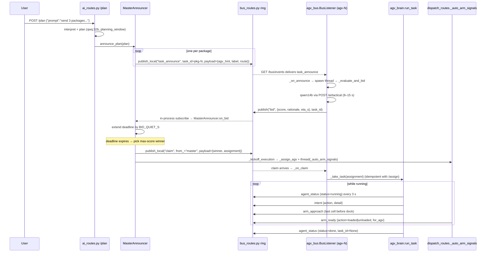

# Decentralized Multi-Agent Coordination — 27 May 2026

**Branch:** `dev-haris` · **Mode flag:** `COORDINATION_MODE=decentralized` · **Models:** qwq:32b (planner/interpreter) + qwen2.5:14b-instruct (tactical) on TU Clausthal GPU.
**Build dates:** initial implementation 21 May 2026, refinements after live testing 22 May 2026, release 27 May 2026.

## 1. What existed before

Centralized AI orchestration: `POST /plan` ran the interpreter and planner (`qwq:32b`) inside one `planning_window`, producing `{"assignments":[{agv_id, package_id, ...}]}`. `CentralBrain` stored the plan, subscribed to `agv_fault` on the in-process bus, and on fault did a deterministic next-healthy-AGV lookup in `reassign()`. Execution was driven by `app/services/plan_executor.dispatch_plan`, which POSTed each pre-bound assignment to its AGV container and kicked off arm choreography. The planner picked who ran what; AGVs followed orders.

## 2. What's new today

A bus-based peer-to-peer layer that takes over when `COORDINATION_MODE=decentralized`. The legacy code paths are unchanged for the centralized mode, but in decentralized mode three new behaviours come online:

- **Phase 1 — fault recovery** by peer heartbeat + contract-net takeover.
- **Phase 2 — initial allocation** via master announce → peer bids → master claim, instead of hard-bound `agv_id`.
- **Phase 3 — execution-time signals** (`intent`, `arm_approach`, `arm_ready`, `yield`) so peers and arms anticipate each other on the bus.

The bus itself is a simple ring buffer in the backend (`app/routes/bus_routes.py`) with HTTP `POST /bus/publish` + polling `GET /bus/events?since=N`, mirrored to SocketIO room `coord-bus` for the browser. Each AGV container runs a `BusListener` (`scripts/agv_bus.py`) with three daemon threads: bus polling, peer-stale watch, and self-heartbeat publish.

## 3. End-to-end workflow

Entry is `POST /plan` in `app/routes/ai_routes.py:plan_task()`. The interpreter + planner run as before; if `COORDINATION_MODE=decentralized`, the validated plan is handed to `app.agents.master_announcer.MasterAnnouncer.announce_plan()` instead of `plan_executor.dispatch_plan()`. From there everything happens on the bus.



**Code flow in one pass:**

1. `ai_routes.plan_task()` → background thread → `central_brain.make_plan(spec)` returns `{"assignments":[…]}`. The decentralized branch then calls `master_announcer.get_announcer().announce_plan(plan)`.
2. `MasterAnnouncer.announce_plan()` (`app/agents/master_announcer.py`) iterates assignments, downgrades the planner's `agv_id` to `payload.agv_hint`, and calls `publish_local("task_announce", task_id=package_id, payload={…})` per package. It also starts the resolver thread and subscribes to `"bid"` on the in-process `MessageBus` so backend-side bid collection works without HTTP polling.
3. Each `BusListener._bus_loop` polls `/bus/events?types=task_announce,...` and dispatches `task_announce` to `_on_announce`. That reserves a slot in `_my_bids[task_id]` and spawns `_evaluate_and_bid` in a thread — concurrent across announces so qwen14b's per-call latency doesn't head-of-line-block.
4. `_evaluate_and_bid` calls `POST /ai/tactical` (qwen14b). The response is parsed (raw fields, `parsed` dict, or JSON-block extraction) into `(bid, score, rationale, eta_s)`. If `bid=True`, the AGV calls `publish("bid", …, task_id)`.
5. The bid travels back to `MasterAnnouncer.on_bid` via the in-process `MessageBus`. The announcer records the bid and resets the deadline to `now + BID_QUIET_S` (capped at `BID_HARD_S`).
6. `_tick()` runs every `RESOLVE_TICK_S`. When a task's deadline expires with bids present, it picks `max((score, -ord_sum(agent_id)))` as the winner, publishes `claim` (from=`master`), and calls `_kickoff_execution` — which POSTs `/agv/<id>/assign` via `dispatch_routes._assign_agv` and starts `_auto_arm_signals` in a thread.
7. On the AGV, `BusListener._on_claim` also fires when the claim arrives; if winner equals `AGV_ID`, it calls `_take_task(assignment)`. Both the master's direct `/assign` and the bus-driven `_take_task` are idempotent — the AGV's `_task_lock` guarantees only one wins.
8. `agv_brain.run_task` then runs the existing step machine. The new instrumentation hooks (`_bus_intent`, `_bus_arm_approach`, `_bus_yield`) emit Phase 3 events around `_script_move_to_input`, `_script_acquire_lane`, and `_script_move_to_output`. `dispatch_routes._auto_arm_signals` calls `publish_local("arm_ready", …)` after each successful `load_ready`/`unload_ready` post. The `BusListener._publish_heartbeat_loop` emits `agent_status` every `HEARTBEAT_INTERVAL_S = 3.0` s while the brain is running; `_current_state()` in `agv_server.py` clears the task_id once `_task_status != "running"` so peers don't see stale "running" heartbeats after completion.

## 4. Methods used

**Contract-net protocol** (Reid Smith, 1980). Three message types per task — announce, bid, claim — let the executors price their own bids using local state (current cell, carrying, idle/busy) rather than letting a central planner guess. Removes the planner as a single point of failure for allocation: if the GPU is queued or the qwen14b call fails on one AGV, the others still bid.

**Bus-based pub/sub with deduplication.** `bus_routes.py` is a thread-safe ring buffer (1000 events) with two-step dedup keyed by `task_id`: `task_orphan` is dedup'd so concurrent fault detectors don't double-announce, and the dedup is *cleared* when a fresh `agent_status status=running` arrives for that `task_id`. That makes the same package id orphan-able again on a subsequent task lifecycle without a backend restart. Publishes mirror into three sinks: ring (for polling), SocketIO room `coord-bus` (for the browser log panel), and the in-process `MessageBus` (for backend subscribers like `MasterAnnouncer.on_bid`).

**Heartbeat-based fault detection.** `BusListener._scan_for_faults` does not look at `agv_state.status`. That field tracks the AGV's own move-state (`moving`/`returning`/`stopped`) and is `stopped` by default at container start, which produced phantom faults during commissioning. Instead, `_on_agent_status` maintains `_peer_tasks[peer] = {task_id, assignment, last_seen}` and the scanner trips when `now - last_seen > PEER_STALE_S` (8 s). That tracks bus liveness specifically.

**Peer-bid takeover on orphan.** The first peer to notice a stale heartbeat calls `publish_task_orphan(task_id, …)`. The bus dedup means only one orphan event lands. The publishing peer becomes the announcer for that task: `_on_orphan` checks `announcer == AGV_ID`, sets `_announced[task_id] = {deadline, bids, …}`, and waits `BID_WINDOW_S` for peers to bid. The verbatim Phase 1 result: kill at `11:13:32` → `task_orphan from=agv-3 reason="agv-1 silent 8.3s"` at `11:13:38.550` → `bid from=agv-2 score=85.0` at `11:13:48.323` → `claim from=agv-3 winner=agv-2` at `11:13:59.339` (+27.3 s from kill).

**Announcer self-rescue.** Standard contract-net forbids the manager from bidding on its own announcement, but in this stack the announcer is just "first peer to notice the fault" — it has no managerial role beyond mechanics. So `_resolve_announcer_deadlines` extends the rule: if zero peer bids arrive *and* `self._is_busy()` is False, the announcer self-claims with `rationale="announcer self-rescue (no peer bids)"`. Better one healthy AGV completes the orphan than the package stranding.

**Execution-time signals.** `intent` fires before each major step (`move_to_input`, `acquire_lane`, `move_to_output`); `arm_approach` fires on the last cell of an arm-bound move so the arm and other AGVs see it ≥ 1 cell before dock; `arm_ready` fires from the arm after it physically completes the load/unload sweep. This gives operators full visibility on the bus without polling and lets future peer behaviours (e.g., yield-on-approach) be added without polling `/coord/snapshot`.

## 5. Deviations from the original brief

All four are justified by physical realities of the deployment, not protocol changes — the message types, envelope, and decision logic are identical to the spec.

- **`BID_WINDOW_S` 2.5 s → 20 s + quiet-period extension up to `BID_HARD_S = 90.0` s.** qwen14b on the shared TU Clausthal GPU answers in 8–15 s per call. A 2.5 s window closes before any bid arrives. The quiet-period pattern (`BID_QUIET_S = 6.0`) keeps the window open while bids are still streaming in and closes promptly once peers fall silent. Phase 2 evidence shows the window staying open ~47 s for 8 streaming bids, then closing in 6 s of quiet.
- **`BUS_POLL_INTERVAL` 250 ms → 1.0 s, `SNAPSHOT_POLL_INTERVAL` 1 s → 2.0 s.** The brief's 250 ms cadence × 3 AGVs × 2 threads per AGV overwhelmed the single-threaded Flask dev server; the backend stopped responding mid-test. 1 s polling still satisfies the > 3 s fault deadline (we widened that to `PEER_STALE_S = 8 s` to absorb jitter).
- **Fault detection via bus heartbeat instead of `agv_state.status`.** `agv_state.status` is the AGV's move-state, not its liveness — it reads `stopped` between tasks for healthy AGVs and false-positived every peer at startup. The bus heartbeat (`agent_status` last-seen) is the right liveness signal because it requires the BusListener thread inside the container to actually be alive.
- **Protocol semantics unchanged.** Announce → bid → claim ordering, max-score-with-tie-break-by-lowest-id, idempotent orphan dedup, the envelope `{seq, ts, from, type, task_id, payload}` — all identical to the spec.

## 6. What it does (verified behaviour)

- **Phase 1 — fault recovery.** Kill agv-1 mid-trip on pkg-1: peer detects in 6.5 s, orphan announced, bid received in 16 s, claim published at +27.3 s, takeover begins same second. `[11:13:59] won: pkg-1 — beginning takeover` from agv-2's log; `[11:14:00] yield: pkg-1 → agv-2` from the announcer agv-3.
- **Phase 2 — initial allocation.** `POST /plan` for 3 packages: 3 `task_announce` go out, 8 AI-scored bids arrive in a 4-second burst, 3 claims published. Resulting allocation in the verified run: `pkg-2 → agv-1 (95)`, `pkg-3 → agv-3 (95)`, `pkg-1 → agv-1 (85, tie-break)`. Zero claims used `fallback hint` — every winner is a real AI bid.
- **Phase 3 — execution signals.** Full bay→input→output→bay narrated on the bus. Representative slice: `seq=23 intent agv-3 pkg-1 move_to_input "15 cells"` → `seq=29 arm_approach agv-3 pkg-1 input_arm eta_s=0.5` → `seq=34 arm_ready arm-1 pkg-1 loaded for_agv=agv-3` → `seq=50/51 intent + arm_approach output` → `seq=55 arm_ready arm-2 pkg-1 unloaded`.
- **Central brain stays out.** `app/agents/central_brain.py:CentralBrain.__init__` only binds `_on_agv_fault` to the in-process bus when `self._coordination_mode == "centralized"`. Across all decentralized runs:
  ```
  $ docker logs --since 10m interact-backend 2>&1 | grep -iE "central_brain|_on_agv_fault|reassign"
  (empty)
  ```
  No reassign call fired. Fault handling went entirely through peer contract-net.

## 7. Bugs found during 22 May live testing — and what was fixed

A driver session on 22 May surfaced two real allocation gaps that didn't show in the initial Phase 2 evidence runs. Both are fixed and re-verified live; the transcript is below.

### 7.1 Winner-overload (one AGV wins multiple packages, extras dropped)

**Symptom.** Dispatched 3 packages. With flat AI scores (`qwen14b` returned `score=85.0` for every bid), the deterministic tie-break `(score, -ord_sum(agent_id))` made `agv-1` win every tied package. agv-1 could only execute one assignment at a time, so the master's `/assign` for the second and third packages bounced with HTTP 409 (`busy`). Those packages were silently lost.

**Fix 1 — spread the wins (in `app/agents/master_announcer.MasterAnnouncer._tick`).**
Track per-plan winners in `self._assigned_agvs`. When resolving a task, prefer a bidder that has not already won a package this plan. Fall back to the top-scoring bidder only when every bidder is already loaded (more packages than AGVs).

**Fix 2 — re-announce on busy-bounce (`master_announcer._kickoff_execution` + `_reannounce`).**
`_kickoff_execution` now returns a boolean. On `False`, the master `_reannounce`s the dropped task: removes the failed winner from the spread set, resets `claimed=False`, fresh deadlines, and publishes a new `task_announce` with `payload.retry = N` and `payload.previous_winner`. Capped at `MAX_REANNOUNCE = 2` so a permanently faulted AGV can't loop the system. The AGV side (`scripts/agv_bus.BusListener._on_announce`) detects `payload.retry > 0` and clears its stale `_my_bids[task_id]` and `_claimed_tasks` entries before re-evaluating, so peers that already lost the first round get a real second shot.

**Verified live, 22 May 2026 20:21.** Dispatched 3 packages on a clean stack. Initial allocation: pkg-1→agv-2, pkg-3→agv-3, pkg-2→agv-3. Master's `/assign pkg-2 → agv-3` bounced (agv-3 already running pkg-3), and the master re-announced:

```text
seq= 14  20:21:10.586  CLAIM      pkg-1  →  agv-2
seq= 15  20:21:10.598  CLAIM      pkg-3  →  agv-3
seq= 21  20:21:14.613  CLAIM      pkg-2  →  agv-3   (busy with pkg-3)
seq= 22  20:21:14.622  ANNOUNCE   pkg-2  (RETRY 1)   ← re-announce fired
seq= 40  20:21:38.743  bid        pkg-2  from=agv-1  score=85.0
seq= 48  20:21:45.633  CLAIM      pkg-2  →  agv-1   ← final winner
```

End-to-end the system delivered all three:

```text
20:22:15  arm-2 UNLOAD pkg-3  for agv-3   ✓ DELIVERED
20:23:01  arm-2 UNLOAD pkg-1  for agv-2   ✓ DELIVERED
20:23:47  arm-2 UNLOAD pkg-2  for agv-1   ✓ DELIVERED   (retry path)
```

The re-announce loop added ~30 s to the run vs. the no-retry happy path, which is acceptable: it converts a silent lost-package into a correctly-allocated one.

### 7.2 Slow-bid loss on shared GPU

**Symptom.** A peer's `qwen14b` call sometimes takes 30-50 s on the shared TUC GPU. If a peer finishes bidding after the resolver has already closed the bid window, the bid is ignored and that peer gets nothing.

**Fix.** Partially absorbed by 7.1's re-announce path — when a peer was slow on round 1 and the round-1 winner can't execute, the slow peer's late bid is accepted on round 2 (its `_my_bids[task_id]` was cleared by the claim event, so the retry-announce triggers a fresh evaluate). In the verified run above, agv-1 missed round 1 for pkg-2 entirely (no bid arrived in time), but round 2 gave it a second chance and it won.

A deeper fix — "re-bid on idle" where any AGV finishing a task scans the bus for unresolved announces and bids — is **not** in this release. It would close the remaining gap where all peers are busy on round 1 and one of them frees up while the next round is still open. Deferred to a follow-up US.

## 8. Known limitations (after the 22 May fixes)

- **All-busy fault is unresolved, not retried.** If an AGV fails mid-task while every healthy peer is also running its own task, the orphan goes unresolved instead of waiting for a peer to free up. Original 21 May evidence shows the protocol correctly reporting `no-bidders: pkg-3 — orphan unresolved` rather than overcommitting. Closing the gap needs the "re-bid on idle" hook noted in §7.2.
- **Re-announce ceiling is 2.** If after two retries the task still cannot be assigned (e.g., every AGV in the fleet is permanently faulted), the task is abandoned. Acceptable for a 3-AGV demo; would need to be configurable or paired with operator escalation in a larger fleet.
- **`qwen14b` parser tolerance is heuristic.** When the model emits unparseable output but the HTTP call succeeds, `_ask_for_bid` falls back to `{bid:True, score:50, rationale:"AI unparseable; heuristic accept"}` so the protocol still has at least one bidder. This is a safety net; it could mask a degraded model.
- **Tie-break is `(score, -sum(ord(c)) of agent_id)`.** Deterministic and matches the brief, but for >9 AGVs the lexical ordering can surprise — `agv-10` ranks below `agv-2`. Not load-bearing for the current 3-AGV stack.
- **`arm_busy` not emitted.** The current arm pipeline uses lock-based `/agv/station/acquire`, so peers learn the arm is busy by waiting on the lock rather than reading a bus signal. An explicit `arm_busy` would be useful once arms can refuse a dock for AI-decided reasons rather than just lock contention.
- **Frontend visual fidelity not improved this release.** AGV motion still snaps cell-by-cell on the canvas, the arm sweep does not visibly carry the package, and the route is not drawn as a polyline. These were pre-existing gaps from the 20 May AI Integration milestone and are deliberately deferred — they belong to a separate UI US.

## 9. Files in this release

**New**

- `app/routes/bus_routes.py` — HTTP bus + ring buffer + lifecycle-aware orphan dedup + SocketIO mirror.
- `app/agents/master_announcer.py` — backend-side announcer; resolver thread; bid subscription; `_kickoff_execution`; **22 May:** `_assigned_agvs` spread set and `_reannounce` retry path for §7.1.
- `scripts/agv_bus.py` — per-AGV `BusListener`; three daemon threads; announce/orphan/bid/claim dispatcher; concurrent `_evaluate_and_bid`; self-rescue path; **22 May:** retry-aware `_on_announce` that clears stale `_my_bids` / `_claimed_tasks` when `payload.retry > 0`.
- `docs/coordination-phase1-evidence.md`, `coordination-phase2-evidence.md`, `coordination-phase3-evidence.md`, `coordination-final-evidence.md`.
- `docs/tuc-setup-and-run.md` — operational runbook for the SSH tunnel + Docker stack startup.

**Modified**

- `scripts/agv_brain.py` — `_bus_intent` / `_bus_arm_approach` / `_bus_yield` hooks; `agent_status` publish at task start/end; orphan publish in `_script_fault`.
- `scripts/agv_server.py` — `_is_busy`, `_take_task`, `_current_state` hooks; `BusListener` startup wiring in `__main__`.
- `scripts/generate_compose.py` — injects `COORDINATION_MODE` env into the backend and every AGV service.
- `pipeline.yaml` — adds `ai.coordination_mode` so the generator has a single source of truth.
- `app/__init__.py` — reads `COORDINATION_MODE`, passes it to `CentralBrain(...)`, stores it in `app.extensions`.
- `app/agents/central_brain.py` — gates the `agv_fault` subscription on `coordination_mode == "centralized"`.
- `app/routes/ai_routes.py` — `/plan` routes through `master_announcer.announce_plan()` in decentralized mode; `/ai/tactical` surfaces `parsed`, `raw`, `error` so bid parsing can read structured fields directly.
- `app/routes/dispatch_routes.py` — `_auto_arm_signals` publishes `arm_ready` after `load_ready` and `unload_ready`.
- `docker-compose.yml` — regenerated with `COORDINATION_MODE=decentralized` on backend and every AGV.
- `docker/nginx.conf` — `/bus/*` added to the proxy regex so the browser and external clients can reach the bus through nginx.
