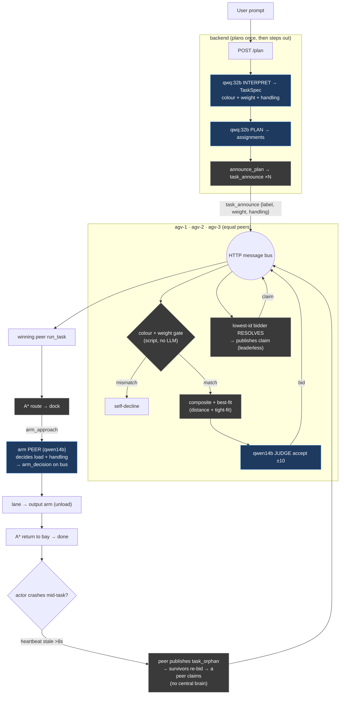

# FDAS — Fully Decentralized Architecture System

*Plan-Once, Self-Coordinating AGVs & Arms.* Branch `dev-haris` · flags `COORDINATION_MODE=smart` + `FDAS_PEER_RESOLVE=on` + `ARM_AUTONOMY=on` · models `qwq:32b` (plan, once) + `qwen2.5:14b` (bid-judge / tactical / arm) on the TU Clausthal GPU. Scope: AI / coordination layer.

**In one line:** after a single AI plan, the AGVs and Arms coordinate among themselves — each bids on packages by capability (colour, weight) and distance, and a **peer, not the backend, resolves the winner**; if an actor fails mid-task, capable survivors re-bid and finish it.

---

## 1. What US-34 delivered → what FDAS changes

| Dimension | US-34 (baseline) | FDAS (this US) |
|---|---|---|
| **Who picks the winner** | The **backend** `MasterAnnouncer` resolves bids and publishes the claim | A **peer** (lowest-id bidder) resolves and publishes the claim — **leaderless**; backend chooses nobody |
| **Fault recovery** | US-32 path — backend/announcer mediated | **Peer-driven** — survivors detect a crashed peer, orphan the task, re-bid, and finish; **no central reassign** |
| **Bid score** | distance + capability + load (3-term composite) | **+ best-fit / overflow** 4th term — tightest capacity wins; heavier AGV only on overflow |
| **Arms** | choreographed backend-side; no autonomy | **AI peers** — each arm runs its own 14B, decides load/unload, publishes `arm_decision` on the bus |
| **Capability model** | colour + weight filter (fixed in pipeline) | **config-driven scenarios** — strict colour-routing **or** colour-free capacity allocation, settings-only switch |
| **Backend role** | coordinator (resolves + dispatches) | **shared infrastructure** — plans once, spawns actors, mirrors the bus; **zero coordination decisions** |
| **Inherited unchanged** | — | US-32 bus + contract-net; US-34 grounded bid, capability/weight filter, A\* routing, `enforce_sequence`, `/capabilities` |

---

## 2. FDAS work done — by build step

| Step | What was built | Where |
|---|---|---|
| **1 — Peer fault recovery** | A faulted/stale peer's task is orphaned **to peers** (was: central reassign / silent abandon); the first peer to notice becomes announcer, survivors re-bid | `scripts/agv_bus.py` `_on_agent_status` / `_scan_for_faults` (`PEER_STALE_S=8s`) |
| **2 — Master-gone peer resolve** | Backend stops choosing winners; every bidding peer collects all bids, the **lowest-id bidder** is the single elected resolver and publishes the claim; backend only drives arm choreography off the peer claim | `scripts/agv_bus.py` `_resolve_fdas_deadlines` / `_on_bid` / `_on_announce`; `app/agents/master_announcer.py` `_tick` guard + `on_peer_claim` |
| **3a — Arms as AI peers** | Each arm runs its own 14B; on AGV approach it decides load/unload and announces `arm_decision` on the bus (real rationales) | `scripts/arm_bus.py`; wired config-driven via `pipeline.yaml ai.arm_autonomy` → `generate_compose.py` → `container_manager` |
| **3b — Arm handling action** | Arm chooses a **handling script** (e.g. gentle vs normal) via 14B and executes it; handling carried on the package | `app/routes/dispatch_routes.py` `_arm_ai_choose_action` / `_arm_ai_gate`; `scripts/arm_bus.py` `_decide_action` |
| **4 — Overflow best-fit** | 4th bid term `+ w_bf·(pkg_weight / weight_max)` rewards tight fit; a heavier AGV wins a light job only when lighter ones are busy. Term omitted when weight unknown (byte-for-byte US-34) | `scripts/agv_bus.py` `_compute_deterministic_score` |
| **5 — Station-jam fix** | A faulted AGV now **releases its input/output station locks** (was leaking → one stuck AGV froze the whole floor) | `app/routes/agv_routes.py` `set_agv_health` |
| **6 — Reused-id fix** | After the first plan, a re-announced package id carried stale per-task state → peers bid but never claimed. Now: `poll_events` returns `did_reset`; a bus reset wipes all per-task state; a fresh non-retry announce of a known id resets just that id and re-bids | `scripts/agv_bus.py` `_reset_all_task_state` / `_reset_task_state` / `_on_announce` |

---

## 3. AI decisions only

Everything quantifiable (distance, capability, weight, load, routing, winner-resolution) is deterministic script. The LLM decides only where judgment is needed.

| Model | Where | Decision |
|---|---|---|
| **qwq:32b** | backend → GPU | Interpret prompt → TaskSpec (once) |
| **qwq:32b** | backend → GPU | Plan → assignments (once) |
| **qwen2.5:14b** | agv-N → GPU | **Bid judge** — accept / ±10 adjust a deterministic score (cannot invent it) |
| **qwen2.5:14b** | agv-N → GPU | **Tactical gate** before each script step (proceed / hold / fault) |
| **qwen2.5:14b** | arm → GPU | **Arm decision** — load/unload + handling action, announced as `arm_decision` |

**What FDAS changed:** the **winner-resolution moved out of the backend into a peer** (deterministic, not an LLM call), and the **arm decision became a real peer LLM call** announced on the bus. The 32B still plans exactly once.

---

## 4. Flowchart

**Reading it:** blue = AI (LLM); grey = deterministic script. The two FDAS hinges are **RESOLVE** (a peer, not the backend, picks the winner) and the **arm PEER** decision on the bus.

---

## 5. Verification ledger

| Behaviour | Result |
|---|---|
| Reused-id fix — claim on the **first** announce (free + colour) | ✅ before: 3 announce rounds; after: 1 |
| **Peer winner-resolution** (claim published by a peer, not backend) | ✅ |
| Smart composite bidding + distance scoring | ✅ |
| **Colour hard-filter** — blue→agv-1, green→agv-2, yellow→agv-3 | ✅ each colour to its sole capable AGV |
| **Weight best-fit + overflow** — 45kg→agv-2 (tight), 15kg→agv-1 (tight), 30kg→agv-3 (overflow) | ✅ tightest capable wins; heavier only when lighter busy |
| **Arm AI** load/unload + handling decision (`arm_decision`) | ✅ |
| **Station-lock release** on fault → no jam | ✅ locks empty, all idle after every fault |
| A\* routing (downstream of the peer claim) | ✅ unchanged from US-34 |
| Two capability scenarios (strict-colour **and** colour-free) pass | ✅ settings-only switch |

---

## 6. Use cases — how the framework applies

FDAS provides three reusable properties: **capability-aware peer allocation** (the right actor takes the job), **leaderless winner-resolution** (no central decision point), and **peer fault-recovery** (survivors finish a dropped job). Those map directly onto domains where a central coordinator is a liability:

- **Warehouse logistics** *(the demonstrated domain)* — heterogeneous AGVs and arms, continuous package flow; each package goes to the nearest capable actor, and a stalled robot's job is picked up by a peer without halting the floor.
- **Vessel / tank cleaning** — a fleet of cleaning robots self-assigns sections by capability and reach; if one is disabled, the others redistribute the remaining sections among themselves.
- **Drone light-shows / formation flight** — formation slots are allocated by position and capability; if a drone drops out, neighbours re-bid for its slot and re-close the formation locally.
- **Military / high-security logistics** — items are admitted and routed by a colour/size/weight policy (the same hard-filter mechanism), and pick-load-deliver proceeds without a central controller that could be jammed or targeted.
- **Space / lunar operations** — round-trip latency to a central master is too high; actors must negotiate and decide locally, exactly as FDAS resolves winners peer-side.
- **Disaster response / search-and-rescue** — in a degraded zone, if one robot is lost the rest reassign its task and continue, with no dependence on a coordinator staying alive.
- **Agriculture / mining fleets** — large heterogeneous fleets with an intermittent central link; capability-based local allocation keeps work flowing through link outages.

**Common thread:** heterogeneous actors + unreliable or absent central comms + a need for local, fault-tolerant autonomy — which is what the verified FDAS behaviours above provide.
