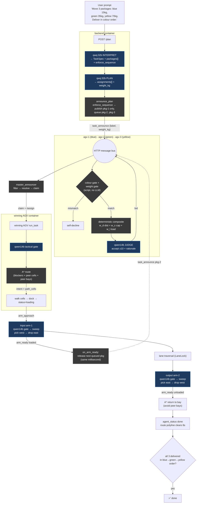

# User Story 34 — Works (consolidated)

> **US 34 — Smart, Grounded, Capability-Aware AGV Coordination.** Consolidated record of everything delivered under US 34 (base + 34.1 differentiation + 34.2 polish) on the `dev-haris` branch. Live acceptance transcripts in [`coordination-us34-evidence.md`](coordination-us34-evidence.md).

**Branch:** `dev-haris` · **Feature flag:** `COORDINATION_MODE=smart` (3rd value on the US 32 flag) · **Models:** `qwq:32b` (interpreter + planner) + `qwen2.5:14b-instruct` (tactical / bid-judge / arm-gate) on the TU Clausthal GPU via `host.docker.internal:11500`. Scope: **AI / coordination layer only.**

---

## 1. One-paragraph summary

US 32 made the *decisions* AI (contract-net over an HTTP bus). **US 34 makes the inputs to those decisions real** — distance, capability, weight, load — so the AI judges on grounded ground instead of heuristic vibes. **US 34.1** makes every difference visible (real per-AGV colour, real weight bands, visible speed, route polyline, live bus mirror, dynamic active-AI badge). **US 34.2** fixed the timing / geometry / rendering bugs that were hiding all of it, and replaced the gridded prototype canvas with an open canvas. The US 32 bus, contract-net, spread-set and fault recovery are inherited **unchanged** underneath. The `decentralized` (US 32) and `centralized` (legacy) flag paths stay byte-for-byte intact.

---

## 2. Work done — by layer

### US 34 base (logic grounding — answers the professor's 7 concerns)

| Phase | Concern | What was built |
|---|---|---|
| M1 — Capabilities schema | #2 #4 #5 #6 #7 | New `app/models/agv_capabilities.py` dataclass (`kind` / `weight_max_kg` / `allowed_labels` / `speed_factor` / `bay_cell`). Read by BOTH backend `agv_state` (from `pipeline.yaml`) AND each containerized AGV (from env via `generate_compose.py`). One source of truth, no inheritance refactor. |
| M2 — Deterministic composite bid | #3 | `scripts/agv_bus.py:_compute_deterministic_score` → `score = w_d·(1−dist/diam) + w_c·cap_match + w_l·(1−load_frac)`. qwen14b becomes a **judge** (±10 adjust + rationale), cannot invent the score. US 32 flat-AI path preserved as `_legacy_us32_ask_for_bid`. |
| M3 — Master capability filter | #4 | `MasterAnnouncer.on_bid` rejects bids whose bidder's `allowed_labels` lacks the task label. Logs `REJECT bid …`. Gated on `coordination_mode_is_smart()`. |
| M4 — `enforce_sequence` | #3 (colour order) | Auto-detected from prompt keywords. When True, master publishes only the first announce; the rest fire from a queue as each prior task hits `arm_ready loaded` — same-millisecond release. Off by default. |
| C4 — `GET /capabilities` | #6 #7 | Backend endpoint returning per-AGV capability table + mode + bid weights + defaults. |
| S1 — A* routing | #1 | `_astar_path` (4-neighbour, Manhattan heuristic) + `_smart_path` wrapper in `scripts/agv_brain.py`. Routes around manual blockers + other-AGV occupancy; falls back to `_straight_path`. |

Concern #5 (parent-class hierarchy unification) is answered at the **schema level** — both paths read the same `AGVCapabilities` shape. A full inheritance refactor is **out of scope → separate US for another developer.**

### US 34.1 differentiation pass (make the differences real + visible)

- **Colour:** AGV-1 = blue, AGV-2 = green, AGV-3 = yellow (was: all accepted everything). The existing two-layer filter now actually fires.
- **Weight bands:** blue 10–20 kg → AGV-1, green 20–50 kg → AGV-2, yellow 50–80 kg → AGV-3. New `ai.weight_bands` table; new `packages:[{label, weight_kg}]` on TaskSpec (qwq:32b-populated, regex fallback); `weight_kg` carried into `task_announce.payload`; dual weight filter (AGV-side decline + master-side `REJECT bid … (weight=X > weight_max_kg=Y)`).
- **Speed:** `MOVE_STEP_SLEEP = max(0.05, 0.5 / AGV_SPEED_FACTOR)` → 0.31 / 0.50 / 0.83 s per cell (1.6× / 1.0× / 0.6×). Three visibly distinct cadences.
- **UI integration (pure rendering of what the bus already carries):** live `socket.on("bus")` mirror (replaces the old `classifyBus` log-scrape), `AgvRouteLayer` A* polyline from `intent.payload.path_cells`, dynamic active-AI badge in `LeftFoot`, bus cap 40→300 / log cap 200→300.
- **Sneh-UI port (visual only, rebuilt against our bus — nothing cherry-picked):** pulsing AGV id labels (`useStatusPulse`), arm id labels, Zones-first sidebar, 10% zoom-out.

### US 34.2 polish + bugfix (4 June — the layer that made it actually render)

Live runs surfaced 12 bugs that made smart-mode unusable. All fixed:

| # | Bug | Fix |
|---|---|---|
| 1 | Route polyline `NaN` since day one | `AgvRouteLayer` read `wh.origin.x`; real origin is `wh.grid.origin`. `const origin = wh.grid.origin ?? wh.origin ?? {x:0,y:0}`. |
| 2 | Output arm geometry inverted (picked the empty side first) | New `_arm_angles_for(station)` derives `(rest, pick, drop)` from real station pixels via `atan2`. Input picks west/drops east; output picks east/drops west. |
| 3 | Arm sweep started while AGV still mid-tween | `_script_move_*` ends with `time.sleep(max(0.7, MOVE_STEP_SLEEP))` → flip `status=loading/unloading` → 0.4 s grace. ~1.1 s visible "docked, then arm starts" gap. |
| 4 | Package teleported table→AGV (no carry) | `_emit_object_owner` emits `object_update` with carrier semantics mid-sweep (`owner=arm` → `owner=asset`/`zone`). |
| 5 | Arm gate poll loop orphaned threads | `_auto_arm_signals` requires cell **AND** `status==loading/unloading` (`_agv_docked_at`); `_arm_ai_gate` cut from 6×2.5 s to 2×1 s fail-fast, proceeds deterministically on wait/error. |
| 6 | Canvas tween 260 px/s cut corners | `setAgvTarget` 260 → 600 px/s so the token snaps to each published cell. |
| 7 | Package rendered in 3 slices at once | New unified `payloads` slice + `PayloadLayer.tsx` (one `<Rect>` per payload, carrier-driven position). Old `tablePkgs` / `armCargo` / brown crate removed. One entity, one place. |
| 8 | "Too gridded" canvas | `WarehouseGridLayer.tsx` rewritten — no floor panel, no grid lines, IN/OUT dashed circles, grey-fill bays, single lane corridor band. |
| 9–11 | Dead pool widget / fake palette chips / invisible bays | Removed `pool-label` node + 5 fake palette chips; grey bay fill. |
| 12 | A* walked through peers' bays | `_smart_path` adds every other AGV's bay cell to `occupied_other`. |
| infra | Browser cached stale `index.html` → none of the FE changes showed | `docker/nginx.conf`: `Cache-Control: no-store` on `index.html` + `/` fallback (hashed bundles keep 30-day cache). |

---

## 3. Prompt → last phase (full execution table)

Every step from the typed prompt to the AGV parked back in its bay. **"Decided by"** = AI or script. **"Where"** = model+container for AI, `function:file`+container for script.

| # | Phase | What happens | Decided by | Which (model / `fn:file`) | Container | Bus emission |
|---|---|---|---|---|---|---|
| 1 | A | User types prompt → `POST /plan` | script | frontend → `ai_routes.py:/plan` | frontend → backend | — |
| 2 | A | Open `planning_window`, warm-load model if cold | — | model load | TUC GPU (Ollama) | — |
| 3 | A | **Interpret** prompt → TaskSpec | **AI** | **qwq:32b** | backend → TUC GPU | — |
| 3a | A | Heuristic: set `enforce_sequence` from ordering words | script | `task_spec.py:validate` | backend | — |
| 3b | A | Heuristic: infer `packages:[{label,weight_kg}]` if LLM omitted | script | `task_spec.py:_infer_packages_from_prompt` | backend | — |
| 4 | A | **Plan** → `assignments[]` (`agv_hint`, `label`, `weight_kg`, `sequence`) | **AI** | **qwq:32b** (same warm load) | backend → TUC GPU | — |
| 5 | A | Carry `enforce_sequence` + `spec.packages` into plan dict | script | `central_brain.py:make_plan` | backend | — |
| 6 | A | GPU swaps qwq:32b → qwen14b for the rest of the run | — | model swap | TUC GPU | — |
| 7 | B | Hand plan to announcer | script | `master_announcer.py:announce_plan` | backend | — |
| 8 | B | If `enforce_sequence`: publish only pkg-1, queue rest. Else publish all. Attach `weight_kg` to each announce. | script | `master_announcer.py:announce_plan` | backend | **`task_announce` ×1 / ×N** |
| 9 | B | Each AGV polls `GET /bus/events` (1 s) | script | `agv_bus.py:BusListener._bus_loop` | agv-1/2/3 | — |
| 10 | B | `_on_announce` spawns a thread per package | script | `agv_bus.py:_on_announce` | agv-1/2/3 | — |
| 11 | B | **Early colour gate** — decline on label mismatch, no LLM | script | `agv_bus.py:_accepts_label` | agv-1/2/3 | — |
| 11w | B | **Early weight gate** — decline if `weight_kg > weight_max_kg`, no LLM | script | `agv_bus.py:_ask_for_bid` | agv-1/2/3 | — |
| 12 | B | Read live `/coord/snapshot.meta` (diameter, weights, stations) | script | `agv_bus.py` | agv-1/2/3 ← backend | — |
| 13 | B | Compute deterministic composite `(score, breakdown)` | script | `agv_bus.py:_compute_deterministic_score` | agv-1/2/3 | — |
| 14 | B | **Bid judge** — `{accept, adjusted_score ±10, rationale}` | **AI** | **qwen14b** | agv-1/2/3 → TUC GPU | — |
| 15 | B | Clamp ±10 + publish bid (or drop / degrade if AI down) | script | `agv_bus.py:_ask_for_bid` | agv-1/2/3 | **`bid` ×M** |
| 16 | B | **Master capability + weight filter** — reject mismatched bids | script | `master_announcer.py:on_bid` | backend | (logs `REJECT bid …`) |
| 17 | B | Append accepted bids; extend deadline `now + BID_QUIET_S` | script | `master_announcer.py` | backend | — |
| 18 | B | Resolve: max(score) → tie-break ord-sum → spread set | script | `master_announcer.py:_tick` | backend | — |
| 19 | B | Publish claim | script | `master_announcer.py` | backend | **`claim` ×1** |
| 20 | B | `POST /agv/<winner>/assign`; on 409 re-announce `retry=N` | script | `master_announcer.py` | backend | **`task_announce(retry)`** |
| 21 | C | AGV brain starts `run_task` (daemon thread) | script | `agv_brain.py:run_task` | agv-N | **`agent_status running`** |
| 22 | C | **Tactical gate** — proceed / hold / fault? | **AI** | **qwen14b** | agv-N → TUC GPU | — |
| 23 | C | Acquire input-station lock | script | `agv_brain.py` | agv-N | — |
| 24 | C | **A\*** route over grid (blockers + peer occupancy + peer bays) | script | `agv_brain.py:_smart_path → _astar_path` | agv-N | — |
| 25 | C | Publish intent + walk cell-by-cell (canvas 600 px/s) | script | `agv_brain.py:_script_move_to_input` | agv-N | **`intent move_to_input` + `path_cells`** + per-cell `agv_update` |
| 26 | C | Settle `max(0.7, sleep)` → flip `status=loading` → 0.4 s grace → approach | script | `agv_brain.py` | agv-N | **`arm_approach input_arm` (eta=0)** |
| 27 | C | **Arm gate** — load now or wait? (fail-fast 2×1 s) | **AI** | **qwen14b** | arm-1 (input) → TUC GPU | — |
| 28 | C | Arm sweep rest→pick(west)→drop(east); carrier transitions | script | `dispatch_routes.py:_auto_arm_signals` + `_arm_angles_for` | backend / arm-1 | `object_update owner=arm-1 → agv-N` |
| 29 | C | Arm signals loaded (3× retry POST) | script | `dispatch_routes.py` | backend / arm-1 | **`arm_ready loaded for_agv=N`** |
| 30 | C | **Sequence release** — pop next queued announce, same ms | script | `master_announcer.py:on_arm_ready` | backend | **`task_announce` (next)** |
| 31 | D | Tactical gate — next? | **AI** | **qwen14b** | agv-N → TUC GPU | — |
| 32 | D | Publish intent, acquire `LaneLock` | script | `agv_brain.py` | agv-N | **`intent acquire_lane`** (+`yield` only on fail) |
| 33 | D | Walk lane cells (config-driven, **not** A* — shared corridor) | script | `agv_brain.py:_script_traverse_lane` | agv-N | **`intent traverse_lane` + `path_cells`** |
| 34 | D | Self-heartbeat every 3 s; peers orphan if >8 s silent | script | `agv_brain.py:_publish_heartbeat_loop` / `_scan_for_faults` | agv-N | **`agent_status running`** |
| 35 | E | Tactical gate — go to output? | **AI** | **qwen14b** | agv-N → TUC GPU | — |
| 36 | E | A* to output dock; settle; `status=unloading`; approach | script | `agv_brain.py:_script_move_to_output` | agv-N | **`intent move_to_output` + `arm_approach output_arm`** |
| 37 | E | **Arm gate** — unload now? | **AI** | **qwen14b** | arm-2 (output) → TUC GPU | — |
| 38 | E | Arm sweep rest→pick(east, off AGV)→drop(west, table) | script | `dispatch_routes.py` + `_arm_angles_for` | backend / arm-2 | `object_update owner=arm-2 → zone` |
| 39 | E | Arm signals unloaded | script | `dispatch_routes.py` | backend / arm-2 | **`arm_ready unloaded for_agv=N`** |
| 40 | F | Tactical gate — return to bay? | **AI** | **qwen14b** | agv-N → TUC GPU | — |
| 41 | F | Release locks; A* return route (avoids peers' bays) | script | `agv_brain.py:_smart_path` | agv-N | **`intent return_to_bay` + `path_cells`** |
| 42 | F | Brain exits `run_task`; route polyline auto-clears 8 s later | script | `agv_brain.py:run_task` | agv-N | **`agent_status done`** |
| — | G | **Fault recovery (US 32, unchanged):** peer heartbeat timeout → first peer publishes `task_orphan` → survivors re-bid (new scoring + filters apply) → announcer-peer claims → central brain stays out | script | `agv_bus.py` / `master_announcer.py` | agv-N / backend | **`task_orphan` → `bid` → `claim`** |

---

## 4. AI decisions only

Every point where an LLM actually decides something. Everything else above is deterministic script. **No new LLM calls were added by 34 / 34.1 / 34.2 — still ~35 per 3-package run, identical to US 32.**

| # | Model | Container → GPU | Decision | Output | Per 3-pkg run |
|---|---|---|---|---|---|
| 3 | **qwq:32b** | backend → TUC GPU | Interpret natural-language prompt | TaskSpec (`packages[]`, colours, weights, `enforce_sequence`) | 1 |
| 4 | **qwq:32b** | backend → TUC GPU | Plan package→AGV assignments | `assignments[]` (`agv_hint`, `label`, `weight_kg`, `sequence`) | 1 |
| 14 | **qwen2.5:14b** | agv-1/2/3 → TUC GPU | **Bid judge** — review deterministic score | `{accept, adjusted_score (±10 only), rationale}` — cannot invent the score | ~9 (per AGV × announce) |
| 22, 31, 35, 40 | **qwen2.5:14b** | agv-N → TUC GPU | **Tactical gate** before each script step | proceed / hold / fault (reads `/coord/snapshot`) | ~18 |
| 27 | **qwen2.5:14b** | arm-1 (input) → TUC GPU | **Arm gate** — load now or wait? (fail-fast, default proceed) | go / wait / fallback | ~3 |
| 37 | **qwen2.5:14b** | arm-2 (output) → TUC GPU | **Arm gate** — unload now or wait? | go / wait / fallback | ~3 |
| | | | | **Total LLM calls** | **~35** |

**What changed vs US 32:** the **count** is identical. What changed is the qwen14b bid role — it was the **author** of a free-form score (mostly flat 85); it is now a **judge** that may nudge a deterministic composite by ±10 with a one-line rationale. Everything qualitative stays AI; everything quantifiable (distance, capability, weight, load, routing) moved to deterministic script.

---

## 5. Flowchart of the work

**Reading the diagram:** blue nodes = AI (LLM) decisions; grey nodes = deterministic script. The bus is the single coordination spine. Note the two places US 34 grounds the AI: the **gate** (script declines before any LLM call) and the **deterministic composite** (script computes the number the LLM may only nudge ±10).

---

## 6. New files & key logic added

**New files**
- `app/models/agv_capabilities.py` — shared capability dataclass (the schema-level answer to concern #5).
- `frontend/src/canvas/overlay/PayloadLayer.tsx` — unified single-entity package renderer.
- `frontend/src/canvas/overlay/agv/useStatusPulse.ts` — status-driven pulse hook (Sneh port).
- `docs/coordination-us34-evidence.md` *(now in `Doc-check/`)* — live acceptance transcripts.
- `docs/us34-learning/` — `PROGRESS.md`, `UI-INTEGRATION-DEFERRED.md`, `phase-{1..6}.md`.

**Key new logic (functions worth naming)**
- `agv_bus.py:_compute_deterministic_score` — the grounded composite bid.
- `agv_bus.py:_legacy_us32_ask_for_bid` — US 32 flat-AI path preserved verbatim.
- `agv_brain.py:_astar_path` / `_smart_path` — dynamic routing.
- `agv_brain.py:_resolve_move_step_sleep` — speed-factor → per-cell latency.
- `master_announcer.py:on_arm_ready` — same-millisecond sequence release.
- `dispatch_routes.py:_arm_angles_for` / `_sweep_angles` — geometry-derived arm choreography.
- `dispatch_routes.py:_emit_object_owner` — carrier-semantics `object_update`.
- `task_spec.py:_infer_packages_from_prompt` — regex fallback when qwq:32b omits structured packages.

**Prompt changes**
- `prompt_builder.py` interpreter prompt now describes the AGV table (colour + `weight_max_kg`), the weight-bands block, and the required `packages[]` JSON shape (label ∈ configured colours; `weight_kg` from prompt or band midpoint, never outside band).

---

## 7. Feature flag

`COORDINATION_MODE` — three values:

| Value | Behaviour |
|---|---|
| `centralized` | Legacy `central_brain.reassign` + `plan_executor.dispatch_plan`. US 34 OFF. |
| `decentralized` | US 32 contract-net via bus. US 34 OFF. **Verified US 32 fallback.** |
| `smart` | US 32 contract-net **+ US 34** capability-aware bidding, distance scoring, weight bands, sequence preservation, A* routing. |

`coordination_mode_is_smart()` exposes the boolean; `coordination_mode_is_decentralized()` covers both `decentralized` and `smart` (smart is a superset that still runs the bus). Flag-off (`decentralized`) verified byte-for-byte equal to the US 32 commits already on `dev-haris`.

---

## 8. Out of scope (tracked, not silent) — needs a separate US / another developer

| Item | Reason |
|---|---|
| Inheritance unification of `VehicleController` + containerized AGV brain | Schema extraction satisfies the architectural need; full refactor is a separate dev's US. |
| LLM-authored bus dialogue (narrated `bid`/`claim`/`arm_ready`) | Scoped as a follow-up user story. |
| Automated pytest coverage for smart-mode + 34.1/34.2 paths | Separate testing US. |
| CI/CD `dev-*` branch + deploy alignment | DevOps US. |
| `acquire_input_station` blocking timing | Backend US — not AI scope. |
| Inspector display of capabilities table | UI integration US. |
